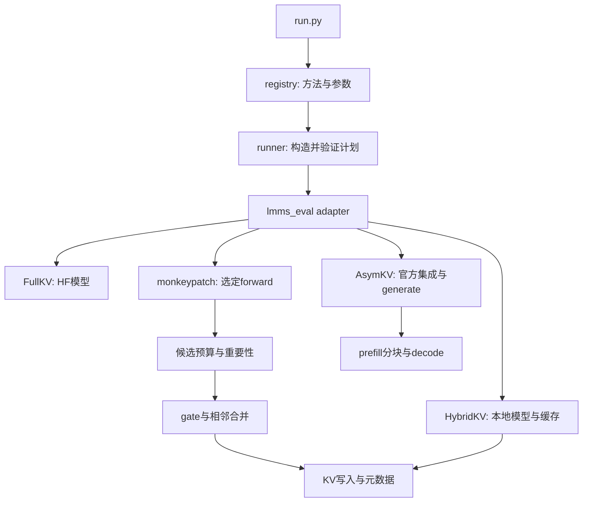

# CPU 调用关系审计（2026-11-03）

审计已完成，发现两个已复现的行为问题。当前不能将 KVRepack 标记为“全部方法正确”或“实验已复现”。本轮新增审计工具、测试和报告，保持压缩核心、原始实验目录及默认参数不变。

## 已确认的问题

| 问题 | 触发条件与结果 | 来源与处理状态 |
|---|---|---|
| LLaVA SparseMM 跨视频预算复用 | 同一模型进程先处理8 token、再处理16 token的CPU样例，第二次仍使用第一次的容量表；与新建对象处理16 token的容量不同。真实视频长度变化也满足该状态触发条件，但未运行视频模型。 | `qwen2_model.py:119` 每次调用 `init_sparsemm`，公共 helper 默认只在首次创建 cluster；容量仅在 `None` 时初始化。该 artifact 文件组合已有这个问题，但原 LLaVA 的 opensource 执行路径每个 prefill 重建，故这里也是相对旧执行路径的组合回归。尚未修复。 |
| AsymKV 丢失最后一个 prompt token | 默认 chunk=512，长度513只转发512 token，长度1025只转发1024 token。长度512/1024则完整。 | `_prefill_like_upstream` 使用 `range(0, prompt_length - 1, chunk_size)`。这是选中原实现继承的行为，并非重命名引入。尚未修复。 |

另有两个直接 API 边界：自定义 Hybrid 文本模型只传 `input_ids` 时先访问空的 `inputs_embeds.shape`；部分 mask 外层模型只传 `inputs_embeds` 时访问空的 `input_ids.device`。当前视频 adapter 传 token 并在外层构造 embeddings，绕开这两项；它们不能表述为默认视频入口已必然失败。

精确源码行号、归属及范围见 [接口审计](../provenance/cache_interface_audit.json)；CPU实际输入和输出见 [小张量报告](../provenance/cpu_compression_audit.json)。

## 检查的调用链



上图概括代码关系。动态分派实测执行了 adapter 中的真实选择语句、真实 monkeypatch/AsymKV installer 和 prepare wrapper，但模型加载器与压缩函数使用禁止执行的替身。它证明分派到哪个符号，不能证明完整 forward 已运行。

静态图只解析明确的本地函数、导入、构造器和当前类方法。PyTorch `__call__`、未知接收者、外部函数及部分 `**kwargs` 仍在边界之外，不将它们算作已验证或错误。

## 本次实测覆盖

- 19 个模型/方法组合，每个在独立进程执行分派；记录 49 次真实 patch 赋值。
- 9个 Qwen prepare wrapper，各检查 `None`、旧 tuple、空缓存、非空缓存；转发值身份与空缓存 reset 均一致。
- 读取本机 Transformers 4.52.3 源码，8项类/构造关系检查通过，另16条 decoder→attention 显式调用签名与返回解包匹配。未导入该模型库运行模型。
- 静态解析33个Python文件、498个函数定义和393个本地调用位置；392处可核对参数，无已确认的参数绑定错误。另5783处外部/动态调用不在这一证明范围内。
- CUDA接口名称：9处调用对应源码中5个 pybind 导出；只核对名称，未编译或调用内核。
- 15项真实CPU小张量检查，torch 2.6.0+cu124、单线程、`CUDA_VISIBLE_DEVICES`为空，CUDA入口调用为0。测试包括gate=0回退、预算边界、raw K/V合并、mRoPE、组长守恒、保护token、group上限、prefill cache写入和decode组元数据。两项上述问题通过复现断言被检出，因此“测试完成”不等于“产品无已知问题”。
- 从14个源文件提取91个原始定义及依赖，记录SHA与行号；实际执行函数AST及部分显式class shell，不执行GPU构造器。对原始artifact的同输入差分包含SnapKV、LookM、MadaKV与Hybrid合并。

详细数据：[分派](../provenance/dispatch_audit.json)、[函数调用图](../provenance/call_graph.json)、[CPU计算与已知问题](../provenance/cpu_compression_audit.json)。调用图的 `method_graphs` 以动态分派选中的函数为种子，列出可静态解析的后续本地调用；不是完整的实际推理trace。

## 实际选中的入口

| 模型 | 方法 | 实测选择的注意力函数或模型类 |
|---|---|---|
| qwen2_5_vl | `fullkv` | `transformers.models.qwen2_5_vl.modeling_qwen2_5_vl.Qwen2_5_VLForConditionalGeneration` |
| qwen2_5_vl | `hybridkv` | `kvrepack.modeling_qwen2_5_vl.Qwen2_5_VLForConditionalGeneration` |
| qwen2_5_vl | `snapkv` | `kvrepack.qwen_model.qwen_flash_attn2_forward_SnapKV` |
| qwen2_5_vl | `sparsemm` | `kvrepack.qwen_model.qwen_flash_attn2_forward_SparseMM` |
| qwen2_5_vl | `madakv` | `kvrepack.qwen_model.qwen_flash_attn2_forward_MadaKV` |
| qwen2_5_vl | `lookm` | `kvrepack.qwen_model.qwen_flash_attn2_forward_LookM` |
| qwen2_5_vl | `randomkv` | `kvrepack.qwen_model_randomkv.qwen_flash_attn2_forward_RandomKV` |
| qwen2_5_vl | `asymkv` | `kvrepack.asymkv_official.attention.qwen2_5_vl_asymkv_official_attention_forward` |
| qwen2_5_vl | `hybridkv_kvrepack` | `kvrepack.modeling_qwen2_5_vl.Qwen2_5_VLForConditionalGeneration` |
| qwen2_5_vl | `snapkv_kvrepack` | `kvrepack.qwen_model_snapkv_kvrepack.qwen_flash_attn2_forward_SnapKVKVRepack` |
| qwen2_5_vl | `sparsemm_kvrepack` | `kvrepack.qwen_model_sparsemm_kvrepack.qwen_flash_attn2_forward_SparseMMKVRepack` |
| qwen2_5_vl | `madakv_kvrepack` | `kvrepack.qwen_model_madakv_kvrepack.qwen_flash_attn2_forward_MadaKVKVRepack` |
| qwen2_5_vl | `lookm_kvrepack` | `kvrepack.qwen_model_lookm_kvrepack.qwen_flash_attn2_forward_LookMKVRepack` |
| llava_ov | `fullkv` | `transformers.models.llava_onevision.modeling_llava_onevision.LlavaOnevisionForConditionalGeneration` |
| llava_ov | `snapkv` | `kvrepack.qwen2_model.qwen2_flash_attn2_forward_SnapKV` |
| llava_ov | `sparsemm` | `kvrepack.qwen2_model.qwen2_flash_attn2_forward_SparseMM` |
| llava_ov | `madakv` | `kvrepack.qwen2_model.qwen2_flash_attn2_forward_MadaKV` |
| llava_ov | `lookm` | `kvrepack.qwen2_model.qwen2_flash_attn2_forward_LookM` |
| llava_ov | `hybridkv` | `kvrepack.modeling_llava_onevision.LlavaOnevisionForConditionalGeneration` |

## 复查命令

在装有项目所固定依赖的 Python 环境内执行；无需 GPU，也不下载权重或数据。

```bash
cd KVRepack
export CUDA_VISIBLE_DEVICES=''
export PYTHONDONTWRITEBYTECODE=1
export PYTHONPATH=src
python scripts/check_sources.py
python scripts/check_dispatch.py > /tmp/kvrepack-dispatch.json
python scripts/check_call_graph.py --dispatch-report /tmp/kvrepack-dispatch.json --output /tmp/kvrepack-call-graph.json
python scripts/check_cpu_compression.py > /tmp/kvrepack-cpu-compression.json
python -m unittest discover -s tests -v
```

`check_dispatch.py` 通过已安装包的 metadata 定位 Transformers 源码，也可显式提供 `--transformers-root /path/to/site-packages/transformers`。不用导入该包。

若仍保留原工作区，可给 `check_sources.py` 和 `check_cpu_compression.py` 增加 `--source-root ..`，执行原源码对照；其他机器不需要原目录即可运行其余检查。缺少 torch/numpy/Transformers 源码时，小张量 unittest 会明确跳过，不能据此声明CPU数值验证通过。完整suite默认跳过原目录差分一项，本次差分已由带 `--source-root ..` 的15项独立CLI检查执行。

## 尚未证明

完整模型加载和生成、真实FlashAttention/CUDA内核、各层完整KV布局、GPU数值一致性、实验分数、显存、时延与吞吐仍需后续验证。首版仍是Qwen的13种组合与LLaVA的6种基线；已发现但尚未迁入的四种LLaVA改进不在本次覆盖内。

发布前应先处理跨视频预算和分块漏token两项问题，记录与旧实现的行为变化，并重新执行对应CPU回归及GPU小样本对照。
