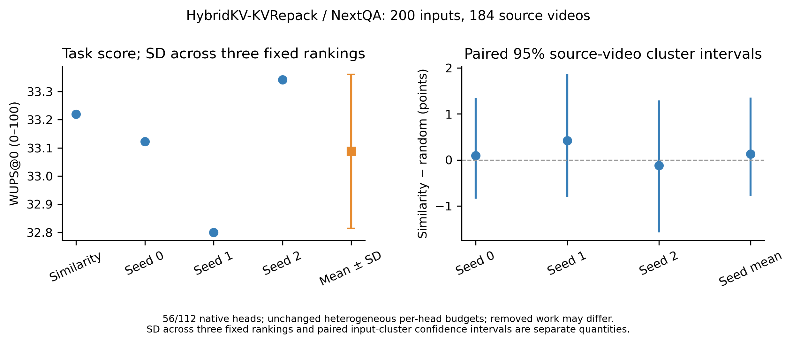

# HybridKV-KVRepack：NExTQA前200条 Random-head 实际结果

**已完成200个问题、四条件共800次生成及离线评分；本前缀未显示相似度选头稳定优于全局Random。** 2026-11-06运行，2026-11-07独立全量执行与评分复核均通过。以下是正式200条结果，与[原SnapKV Random-head结果](RANDOM_HEAD_NEXTQA_200_RESULTS_20261104.md)分开保存，不拼接预测或分数。

## 分数与不确定性

模型为Qwen2.5-VL-7B-Instruct，方法为HybridKV-KVRepack；NExTQA OE/test原始`doc_id=0..199`包含184个源视频。完整参数与复现入口见[协议](HYBRID_RANDOM_HEAD_NEXTQA_200.md)。主指标使用原任务WUPS@0聚合，单位为0–100分；下表差值均为“相似度策略−Random”，保留负值。

| 选择策略 | WUPS | 相似度策略−Random | 差值的95%配对聚类区间 |
|---|---:|---:|---|
| 原相似度选择 | 33.219903 | — | — |
| Global Random seed0 | 33.122167 | +0.097737 | [−0.842551, 1.344120] |
| Global Random seed1 | 32.799673 | +0.420231 | [−0.796044, 1.860325] |
| Global Random seed2 | 33.342348 | −0.122444 | [−1.576544, 1.290349] |
| Random三seed均值 | 33.088063 | +0.131841 | [−0.778808, 1.353447] |

Random三seed的样本标准差为**0.272940**（`ddof=1`）。均值略低于原策略，但seed2高于原策略，所有差值区间均跨0。因此这些结果不支持稳定优越，也不能证明两种策略等效或全量没有差异。

区间使用184个源视频聚类的5000次配对bootstrap，抽样seed为20261104：共同重采样视频并保留其所有问题，各条件共用抽样，问题等权。Random均值区间条件于三个固定种子；三seed标准差与输入聚类置信区间反映不同不确定性，不能将600个seed×问题组合当作600个独立输入。

[PDF](../provenance/hybrid_random_head_nextqa_200_20261106/report/nextqa_scores.pdf) · [SVG](../provenance/hybrid_random_head_nextqa_200_20261106/report/nextqa_scores.svg) · [机器可读汇总](../provenance/hybrid_random_head_nextqa_200_20261106/report/summary.json)

## 控制条件与合并量限制

四条件共用相同输入、原生分类、逐头保留预算及`pre_selection`快照；模型、64帧、10%预算、`.5/.5/2`合并参数、原`raw_reapply`路径和生成设置相同。原生KV头为28层×4头，共112个；每条件每输入均选56头，并实际执行56次有效合并。Random在112头上均匀无放回选择固定模型级集合，分别使用seed0/1/2，不逐输入重抽。

**这是全局同选头数的干预，合并工作量并非严格相同。** Global Random也改变层间分布以及选中头的类别组成。Hybrid原生每头预算异质，即使保持同一头的预算与原算法不变，选择不同的头仍会改变实际候选扩张和移除token量。正式报告记录如下：

| 选择策略 | 每输入平均移除token数 | 200输入累计移除token数 | 移除量与原策略不同的输入数 |
|---|---:|---:|---:|
| 原相似度选择 | 206339.105 | 41,267,821 | 0 |
| Random seed0 | 195490.295 | 39,098,059 | 200 |
| Random seed1 | 202084.690 | 40,416,938 | 200 |
| Random seed2 | 175985.215 | 35,197,043 | 200 |

上述计数累加全部真实head合并调用的`before−after`，不是互不重复的视频token数。实验没有为对齐移除总量而修改分类、每头预算、候选或原合并代码，也没有通过重采样掩盖差异。因此本轮不能称为同时固定层配额和合并工作量的纯头身份对照，不能只凭同选56头作此宣称。

独立执行审计还确认，Random seed0/1/2分别改变10、16、9条完整答案，但各组首个输出token全部相同。当前Hybrid实现的prefill注意力使用完整K/V，压缩缓存影响后续解码，见[已有源码路径核对](../provenance/rope_merge_qwen7b_200_20261106_stopped/nextqa_prefill_scope_check.json)。本前缀答案仅2–6 token（含EOS），这一结构可能限制短答案测试对选头变化的敏感性；首token相同不表示后续内容或EOS不受压缩影响。

## 完成状态、计时与证据

正式worker于2026-11-06 UTC 07:00:00开始，07:47:28结束，墙钟约**47分27秒**，包含输入处理和生成流程；离线正式计分为**10.771秒**。控制器从06:59:56到07:47:42，总墙钟约47分46秒。四条件各200次生成均以EOS结束，达到128 token上限和未EOS截断的计数均为0；生成长度范围为2–6 token。

运行内配对门禁和正式报告的`audit.status`记录为`passed`，涵盖原行/视频身份、输入及原候选指纹、原mask、实际分类、每头预算、56选头与56有效合并、固定随机集合及非选择配置。

2026-11-07的[独立全量执行审计](../provenance/hybrid_random_head_nextqa_200_20261106/independent_execution_check.json)另以独立逻辑读取全部样本，状态为`passed`、问题数为0：

- 全部800条生成记录均选56头并执行56次有效合并；600组Random/原策略配对的输入、完整`pre_selection`快照及非选择配置相同。
- 独立重建三个固定种子的均匀无放回排序，并核对16份冻结源码及内核SHA。
- 原相似度策略与旧Hybrid raw基线200条的输入、生成token与文本、原生mask及分组完全一致。
- Random seed0/1/2相对原策略分别改变10/16/9条预测文本；所有配对的首个生成token相同，后续token可受缓存差异影响。

执行审计没有重跑GPU、视频准备或评分。另有[独立评分复核](../provenance/hybrid_random_head_nextqa_200_20261106/independent_scoring_check.json)通过：800次原生WUPS不复用预测缓存逐次重算，逐问题分数、600组配对差值、三seed样本标准差及184视频聚类区间均一致，逐条分数和CI的最大误差为0；正式报告12份文件的SHA前后不变。当前机器内存有限，复核直接加载已安装pywsd原tokenizer/utils AST及相同WordNet，仅绕过无关包级WSD预热，函数原语义和来源SHA保留在审计中；未改安装包或实验源码。

完整本机数据保存在`outputs/ablations/hybrid_random_head_nextqa_200_20261106/`；发布用证据目录为[`provenance/hybrid_random_head_nextqa_200_20261106/`](../provenance/hybrid_random_head_nextqa_200_20261106/)。其中[原报告](../provenance/hybrid_random_head_nextqa_200_20261106/report/RESULTS.md)、[逐问题评分](../provenance/hybrid_random_head_nextqa_200_20261106/report/scores.csv)、[配对评分](../provenance/hybrid_random_head_nextqa_200_20261106/report/paired_scores.csv)、[选头审计](../provenance/hybrid_random_head_nextqa_200_20261106/report/selector_audit.csv)、[合并工作量](../provenance/hybrid_random_head_nextqa_200_20261106/report/merge_work.csv)及[生成统计](../provenance/hybrid_random_head_nextqa_200_20261106/report/generation_summary.csv)分别保留分数与执行事实。

本轮仅NExTQA前200条，不含VATEX、全测试集或逐层配额匹配。此前[RoPE合并实验](ROPE_MERGE_ABLATION.md)继续保持`stopped_by_user`，不因整理本报告自动续跑。
