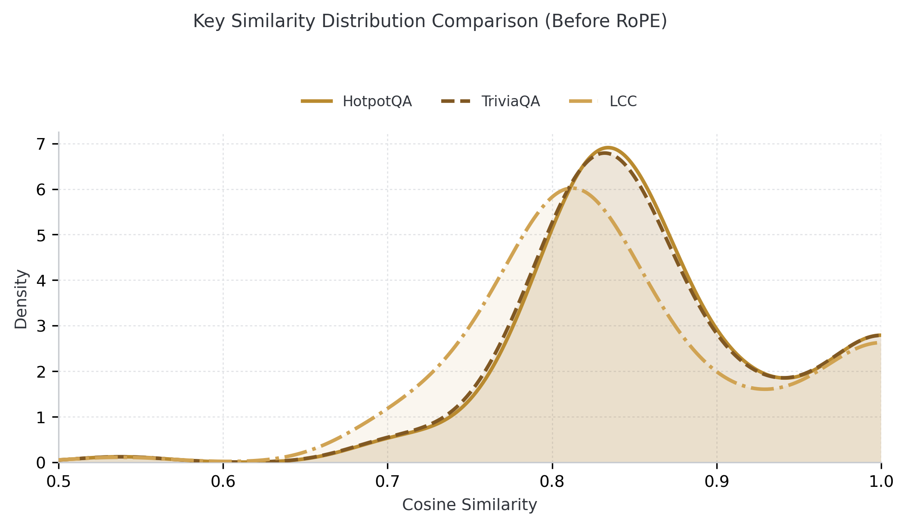

# 其他LongBench子集：高相邻K并非Qasper特例

新增HotpotQA、TriviaQA、LCC各原始前200条，共600条，全部完成。固定Qwen2.5-7B-Instruct，主指标仍是完整序列全部`N−1`个`(i,i+1)`的RoPE前raw K余弦；不取top200、不抽样、不截断。Qasper与VATEX两行复用各自此前的200条完整邻接统计。

| 数据集 | 模型 | 输入数 | RoPE前K全部邻接均值 |
|---|---|---:|---:|
| Qasper | Qwen2.5-7B | 200 | 0.843658 |
| HotpotQA | Qwen2.5-7B | 200 | 0.850863 |
| TriviaQA | Qwen2.5-7B | 200 | 0.849428 |
| LCC代码 | Qwen2.5-7B | 200 | 0.831356 |
| VATEX视频 | Qwen2.5-VL-7B | 200 | 0.740228 |

三个新文本子集均在0.831至0.851之间，因此本批高值不是Qasper独有现象。不同模型/任务/prompt与长度仍不相同，不能将该表直接解释为模态自身的因果效应。

[TXT](longbench_adjacent_controls_200.txt) · [主比较CSV](longbench_adjacent_controls_200.csv) · [全部六指标与诊断CSV](longbench_adjacent_controls_diagnostics_200.csv) · [协议与启动命令](LONGBENCH_ADJACENT_CONTROLS_20261117.md)。

[分布图PDF](../provenance/longbench_adjacent_controls_20261117/final/report/raw_k_adjacent_controls.pdf)。每条曲线包含28层×4个原生KV头的112个输入等权均值；是层头均值的KDE，不是全部原始pair余弦的密度。

## 高值的可检验线索

相邻token通常共享局部上下文。此次同一向量的邻接均值0.831至0.851，高于其非自身全配对均值0.673至0.696。该比较直接说明“邻接”和“所有不同位置”是不同统计对象，不等于全部远距token同样接近。

此外，raw K是注意力投影而非经过校准的语义相似度表示。`K_i = W_K h_i + b_K`中的共同偏置，以及整个序列共享的方向分量，都可能抬高归一化后的点积。以下在同一次原生前向捕获的副本上做事后诊断：

| 子集 | 原raw K邻接 | raw K全配对 | 减序列均值后的邻接 | 事后减投影bias后的邻接 |
|---|---:|---:|---:|---:|
| HotpotQA | 0.850863 | 0.696224 | 0.453046 | 0.690903 |
| TriviaQA | 0.849428 | 0.693112 | 0.455759 | 0.684255 |
| LCC | 0.831356 | 0.672503 | 0.439373 | 0.659695 |

三组方向一致，支持共同方向/偏置分量影响原始K余弦的解释。这与注意力表示各向异性的研究方向一致，但文献本身不是本模型的机制证明：[Godey et al., EACL 2024](https://aclanthology.org/2024.eacl-long.3/)。

减均值按每输入、每头在FP32中计算；减bias作用于已BF16舍入的投影副本，随后重新归一化。模型的参数、注意力和前向结果未修改，不能把该列称作“关闭bias重新运行模型”。余弦归一化是非线性的，两种诊断互有关联，差额不能相加当作贡献比例，也不证明压缩后任务性能。此轮未对VATEX做同样的去均值/去bias诊断，不能据此独立解释两模型差异。

## 执行与复核

实际PID26885于UTC2026-11-17T02:00:37至02:09:13完成600条，worker计时515.992739秒（约8分36秒，含模型加载与采集，不含报告和依赖导入）。三个子集逐条顺序运行，共用一个模型；2×3 pilot6条另存，不并入正式600条。首个launcher日志位置导致参数检查拒绝，未加载模型或推理，已保留记录并修复；未重复正式结果。

新增9项诊断、3项输入和10项报告CPU检查均通过。独立程序从固定原ZIP行、官方模板和原生chat重新构建600条输入，token长度与input_ids/attention_mask SHA全部匹配；6个指标、112头、4类CSV和汇总验证通过，最大余弦均值误差2.22e−16。模型metadata、与旧Qasper共用的依赖版本及8个冻结数值文件SHA一致。30份压缩核心保持不变，无新增视频或生成benchmark。

[独立审计](../provenance/longbench_adjacent_controls_20261117/independent_verification.json) · [发布清单](../provenance/longbench_adjacent_controls_20261117/final/release_manifest.json) · [原始运行压缩包](../provenance/longbench_adjacent_controls_20261117/final/recorded_run.tar.gz)。完整原向量未保存；独立审计复算的是保存的层头均值和输入，而不是从原向量重算诊断，后者由CPU显式oracle和原生采集路径支持。

ROOT为`outputs/observations/longbench_adjacent_controls_200_20261117`。采集源码`02985fd`，报告`2701b4a`；来源、raw归档、逐文件SHA和完整报告位于`provenance/longbench_adjacent_controls_20261117/final`，不上传长文本原文或权重。
