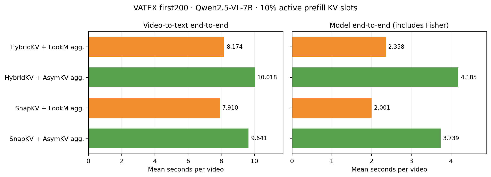

# VATEX 固定分组合并：结果与时延

Qwen2.5-VL-7B、A800-SXM4-80GB、64帧、VATEX原始前200条。四组共800个结果：228个保留自先前已完成记录，572个新增；用户要求停止后，未再补跑KVRepack基线。

论文用原格式三列 LaTeX/TXT：[结果表](merge_compensation_table_with_timing.txt)。保留原稿分数，追加 SnapKV 三种合并；时延为秒/条，历史时延参考用†及脚注注明。

LookM与AsymKV只迁入聚合规则及必要的Fisher/LMA依赖，候选、选头、分组、anchor、raw-K重施mRoPE和活跃KV预算在同骨干内一致。它们不是完整原算法结果。协议见[实验方案](MERGE_AGGREGATION_VATEX_200.md)。

| 骨干 | 聚合 | B-4 | CIDEr | METEOR | R-L | Avg. |
|---|---|---:|---:|---:|---:|---:|
| HybridKV | LookM 式聚合 | 0.219633 | 0.468165 | 0.221619 | 0.427417 | 0.334209 |
| HybridKV | AsymKV 式聚合 | 0.178995 | 0.387725 | 0.207112 | 0.410441 | 0.296068 |
| SnapKV | LookM 式聚合 | 0.216159 | 0.458444 | 0.213408 | 0.426181 | 0.328548 |
| SnapKV | AsymKV 式聚合 | 0.181163 | 0.354224 | 0.199085 | 0.403201 | 0.284418 |

每输入时延单位为秒。完整端到端包含视频读取/解码、processor、H2D、Fisher（AsymKV）、prefill、decode、文本解码；模型端到端包含输入已在GPU之后的Fisher与generation。加载、预热、AST编译、张量审计哈希、写盘和评分另计。

| 骨干 | 聚合 | 模型端到端均值 | 完整端到端均值 | P50 | P95 | Fisher均值 | 无EOS上限数 |
|---|---|---:|---:|---:|---:|---:|---:|
| HybridKV | LookM 式聚合 | 2.357584 | 8.173605 | 5.066913 | 25.197800 | 0.000000 | 1 |
| HybridKV | AsymKV 式聚合 | 4.185451 | 10.017878 | 6.823433 | 26.741837 | 1.612517 | 8 |
| SnapKV | LookM 式聚合 | 2.000925 | 7.909557 | 4.726065 | 25.817936 | 0.000000 | 0 |
| SnapKV | AsymKV 式聚合 | 3.738625 | 9.640830 | 6.391827 | 27.147535 | 1.615247 | 9 |

所有条件最多生成64个新token、greedy、repetition penalty=1.05。AsymKV式聚合在HybridKV/SnapKV上分别有8/9条无EOS达到上限；这些输出保留并正常计分。实际生成长度也不同，因此上述端到端差值包含输出长度效应，不能单独解释为merge算子耗时。

## 已有114条同输入配对

以下只使用停止前已经生成的SnapKV原始前114条，三种聚合使用同一批参考。该表的CIDEr按114条自己的参考语料计算，与上面的200条表分开。

| 聚合 | N | CIDEr | Avg. | 模型端到端均值 | 完整端到端均值 |
|---|---:|---:|---:|---:|---:|
| KVRepack | 114 | 0.482117 | 0.341163 | 1.959640 | 8.298082 |
| LookM 式聚合 | 114 | 0.480605 | 0.340184 | 1.964442 | 8.266790 |
| AsymKV 式聚合 | 114 | 0.387079 | 0.302239 | 3.658765 | 9.964290 |

这114条中，LookM式聚合与KVRepack的质量和模型端到端时延接近；AsymKV式聚合分数较低且含额外Fisher开销。这里没有完整200条、相同计时口径的HybridKV+KVRepack基线，不用旧nominal预算或含审计的时延补齐该行。

## 核对与文件

- 活跃prefill KV位置均不超过10%。HybridKV为保留异质head分配的全局预算，SnapKV为统一逐head预算；近期窗口已包含。该比例不等于总VRAM比例，HybridKV backing/offload和Fisher工作空间另计。
- 400条输入、800个结果的实际候选、选头、分组、anchor、预算、首token与来源链独立审计通过；228个复用结果保持原预测、原顺序与原时延。
- 从raw bundle重新构造预测并原生复算4×200和3×114共7个corpus；496项数值比较最大误差0，914个唯一生成token解码全部一致。原raw/report文件SHA不变。
- 发布前CPU suite313项：312通过、1项原有跳过；本地来源/AST/SHA检查通过，原30个核心文件未改。原工作区参考文件缺失使可选source-root比较不可执行，已保留说明。

[200条完整CSV](merge_aggregation_vatex_200.csv) · [114条配对CSV](merge_aggregation_snapkv_114_matched.csv) · [时延PDF](figures/merge_aggregation_vatex_200/latency_comparison.pdf) · [证据目录](../provenance/merge_aggregation_vatex_200_20261112/README.md)

运行入口：`scripts/run_merge_vatex.py`，默认仅LookM/AsymKV；结果汇总：`python -m kvrepack.ablations.merge_comparison_report`；独立结构审计：`scripts/audit_merge_vatex.py`。

本机完整运行记录：`outputs/ablations/merge_vatex_mergeonly_200_20261112/`；旧114条父记录保留于`outputs/ablations/merge_vatex_200_20261112/`，禁止恢复其baseline生成。

## 旧运行计时追溯（2026-11-12）

从 `/tmp` 专用日志恢复了 VATEX7B、64帧、200条的历史模型生成计时：SnapKV+KVRepack 为 **2.100160s**（Avg **0.330672**），HybridKV+KVRepack 为 **2.443860s**（同运行 Avg **0.343937**，原稿 **0.3447** 来自另一运行，论文表保留原分数并将旧时延标为†参考）。旧 Generation 包含视觉编码、prefill、decode，但无显式 CUDA 同步；不含视频处理/H2D/文本解码。旧预算另加近期窗口，生成配置也未与本轮完全冻结一致；模型阶段计时保留在来源记录中；论文表只填写完整流程 E2E，历史响应循环近似计时标†。

原生 HybridKV 的旧 pair 日志缺少 Generation 打印，但 tqdm 保留了响应循环总耗时：原生 **26:28/200≈7.94s/条**、HybridKV+KVRepack **26:37/200≈7.99s/条**；SnapKV+KVRepack 为 **24:31/200≈7.36s/条**。这段循环包含视频处理至文本输出及循环工作，排除模型加载和评分，只有整秒显示精度，故在论文 E2E 表中用≈和†脚注。新四组与历史预算/生成/计时设置不同，不据此计算严格配对加速比；原生 SnapKV 的同次旧记录也已从停止快照恢复：Avg **0.331264**、响应循环 **23:59/200≈7.20s/条**，已加入论文表基线行；FullKV 的对应记录仍未找到。原日志、400条阶段值和来源核对见[追溯证据](../provenance/merge_timing_recovery_20261112/README.md)。旧计时存在不等于与本轮具有相同计时范围。

SnapKV 同输入114条中，LOOK-M 完整 E2E 比 KVRepack 少0.031292s，主要来自预处理少0.035756s；模型生成反而多0.004803s。这些完整时延包含预处理波动及生成长度差异，不能当成纯 merge 算子耗时或稳定加速证据。
