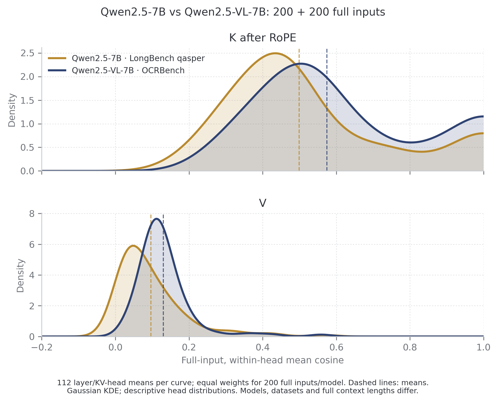

# Qwen2.5完整输入200＋200结果

400/400规定输入已完成，GPU已释放。文本为Qwen2.5-7B-Instruct处理LongBench/qasper原0..199，图文为Qwen2.5-VL-7B-Instruct处理OCRBench原0、5…995。全部输入token参与非自身全配对，未截断、换样本或抽样token；[固定协议与复现命令](MIXKV_REFERENCE_200.md)。

**2026-11-12 绘图更新：** 主图与 raw-K 补图已改为连续高斯核密度曲线（KDE），参考 MixKV 图1(b)的分布展示形式。配色取用户提供 PDF：纯文本金棕 `#B98A2F`，图文深蓝 `#2F4373`；浅色填充和虚线分别表示密度估计与原始均值。仍使用每模型112个层/KV头均值，400条原始记录、所有CSV、均值和置信区间的文件哈希均未改变。只重绘，没有运行GPU或重新采样。[绘图核对](../provenance/mixkv_reference_qwen25_200_20261104/continuous_plot_update_20261112.json)。

**扩大到200＋200后，post-RoPE K和V仍为图文组均值更高；raw K仍是文本组更高。**

| 指标 | 纯文本 | 图文 | 图文减纯文本 | 差值95%来源聚类区间 |
|---|---:|---:|---:|---|
| raw K | 0.677931 | 0.592037 | −0.085894 | [−0.089431, −0.082514] |
| post-RoPE K | 0.498643 | 0.574448 | +0.075805 | [+0.072580, +0.078912] |
| V | 0.096660 | 0.130154 | +0.033494 | [+0.030272, +0.036592] |

主图上为RoPE后K、下为V；每模型112个层/原生KV头的跨200输入均值。没有把112个头当成独立输入。两组分布仍有重叠，均值差异不是所有层头或每个输入都同向的声明。



[主图PDF](../provenance/mixkv_reference_qwen25_200_20261104/report/reference_main.pdf) · [SVG](../provenance/mixkv_reference_qwen25_200_20261104/report/reference_main.svg) · [raw K补图](../provenance/mixkv_reference_qwen25_200_20261104/report/reference_raw.png) · [数值CSV](../provenance/mixkv_reference_qwen25_200_20261104/report/comparison_summary.csv) · [完整汇总](../provenance/mixkv_reference_qwen25_200_20261104/report/summary.json)。

## RoPE为什么改变排序

RoPE对位置i的K施加正交旋转R_i。相同的旋转作用于两个向量会保持余弦；不同位置的旋转不同，则：

```
cos(R_i k_i, R_j k_j) = k_i^T R_i^T R_j k_j / (||k_i|| ||k_j||)
```

相对旋转项R_i^T R_j会改变夹角。二维玩具例子中，两个原本相同的向量，如果相对旋转90度，余弦就从1变成0；这不等于内容信息被丢弃。RoPE也不保证每一对向量的余弦都随距离增大而下降。[RoFormer原论文](https://arxiv.org/abs/2104.09864)。

本轮同一前向内的阶段变化为：

| 条件 | raw K | post K | 阶段变化 |
|---|---:|---:|---:|
| 纯文本 | 0.677931 | 0.498643 | −0.179289 |
| 图文 | 0.592037 | 0.574448 | −0.017589 |

文本组下降明显更多，导致组间排序由raw负差翻为post正差。这是实际向量上的阶段差异，不是更换采样或重跑后挑选的结果。

Qwen2.5文本使用线性位置；Qwen2.5-VL图像token按时间/高度/宽度分通道编码，单张图片的时间坐标固定、高宽按网格变化。文本token三轴位置相同并递增，因此两种位置布局的相对旋转分布不同。长文本全配对还覆盖更广的位置间隔，这些因素可以影响平均余弦，但本实验未把它们独立隔离。[固定版本原生实现](https://github.com/huggingface/transformers/blob/v4.52.3/src/transformers/models/qwen2_5_vl/modeling_qwen2_5_vl.py#L627-L670)，[Qwen2.5-VL技术报告](https://arxiv.org/html/2502.13923v1#S2.SS1.SSS3)。

raw K只表示**当前层**施加RoPE前的投影，仍包含前层注意力及视觉编码器的位置影响；它不等于完全去除位置编码的纯语义表示，也不是关闭全模型RoPE的消融。图文统计是整个prompt，不是仅image-token池。两个条件同时改变模型权重、数据、长度和位置布局，不能把阶段差额全部归于模态或长度，更不能仅据post-K相似度宣布视觉语义天然更冗余。

## 实际输入与区间

| 条件 | 输入数 | 不同来源SHA数 | token范围 | token均值/中位数 |
|---|---:|---:|---:|---:|
| Qasper | 200 | 148个context | 2094–22064 | 5211.42 / 4822.5 |
| OCRBench | 200 | 199张原图 | 61–16308 | 1076.28 / 245 |

图像token范围33–16264。原图编码字节完整保留，按既定原生处理流程缩放；未为得到某种方向而改变分辨率。重复来源全部保留：Qasper有105个单次、34个两次和9个三次context；OCR有198个单次和1个两次原图。

点估计按输入等权，先平均各输入的原生KV头和层。95%区间采用5000次来源整组bootstrap，seed20261104；文本按context SHA、图文按原图SHA，两组独立采样，保留重复来源的全部成员并按抽后行数取均值，不按doc_id或head跨组配对。它是对本轮固定数据选择的探索性区间，不是整个文本/视觉领域的总体因果估计。

## 验证与时间

- 两组各200、无遗漏/失败，28层×4原生KV头完整；全部真实长度低于各自原生窗口，无截断。
- 与此前5＋5重叠的10条，输入张量字节hash完全一致，全部层/头/三个指标最大差为0。
- 原生捕获/归约模块未改；扩大只涉及显式数量、输入行号和统计。完整CPU suite175项，174通过、1项旧来源差分跳过；来源检查通过。
- 独立重算均值最大误差约2.22e-16；独立重算所有聚类区间误差为0；各图曲线完整保留112个头，原始数据方向、负值和raw对照均保留。
- 文本worker91.569秒、图文worker75.832秒，合计**167.401秒，约2分47秒**，含模型加载。父调度端到端178.513秒，约2分59秒，含两个进程启动/依赖导入；不含入口扩展、输入准备、检查和绘图。本次准备耗时超过先前基于小批量运行的简单估算，以上数字不作为推理性能基准。
- 两个worker和调度已结束、GPU释放，不自动扩展至更大范围。代码/契约、400条原始统计、去正文的来源清单、图表/CSV及核对结果见[证据索引](../provenance/mixkv_reference_qwen25_200_20261104/artifact_index.json)。全文文章、原图和模型权重不加入Git。

本实验参考MixKV图1(b)的比较形式，并按用户假设明确使用post-RoPE K作主图。原论文图1的精确采集时点未公开确认，且原图使用Qwen2系列，因此仍不能称原图的严格数值复现，也不证明合并无损。
