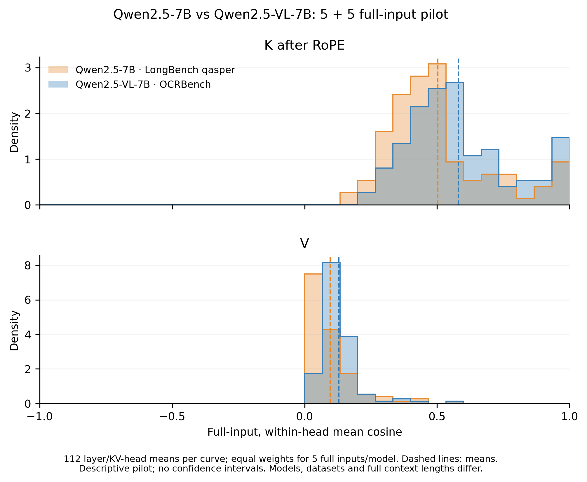

# Qwen2.5 完整输入5＋5小批量结果

本轮已完成且停止，没有自动扩大实验。Qwen2.5-7B-Instruct使用LongBench v1/qasper/test原始前5条完整长文本；Qwen2.5-VL-7B-Instruct使用OCRBench固定行0、200、400、600、800的完整图文。详细设置见[协议](MIXKV_REFERENCE_PILOT.md)。

**RoPE后K和V的组均值为图文更高；raw K方向相反。** 两组分布有明显重叠，不能写成严格复现MixKV的数值或视觉语义必然更冗余。

| 指标 | 纯文本Qwen2.5 | 图文Qwen2.5-VL | 图文减纯文本 |
|---|---:|---:|---:|
| raw K | 0.677177 | 0.595588 | −0.081589 |
| RoPE后K | 0.503055 | 0.579701 | +0.076646 |
| V | 0.095860 | 0.129328 | +0.033468 |

主图上为RoPE后K、下为V，均值虚线和全部112个层/原生KV头均保留。每头先对五个完整输入等权平均；没有token抽样、top-k、截断、排除不利层/头或样本长度加权。

[主图PDF](../provenance/mixkv_reference_qwen25_20261104/report/reference_main.pdf) · [raw K补图](../provenance/mixkv_reference_qwen25_20261104/report/reference_raw.png) · [机器可读汇总](../provenance/mixkv_reference_qwen25_20261104/report/summary.json) · [逐输入表](../provenance/mixkv_reference_qwen25_20261104/report/record_summary.csv)。

## 捕获阶段是本轮的重要发现

从同一批实际向量的raw K到RoPE后K，文本组均值下降**0.174122**，图文组下降**0.015887**。所以两组的K排序在施加位置旋转前后发生翻转。该数值分解直接来自同一前向中的两个捕获点；不能进一步认定由“视觉语义冗余”或“序列长度这个单一因素”造成。两模型使用不同的位置布局，模型参数、训练和语料也不同。

作者[公开Qwen实现](https://github.com/xuyang-liu16/MixKV/blob/eeb708bc3be65beade00e231a7b2c2160995f3c5/mixkv/qwen_model.py#L76-L87)先对Q/K施加RoPE，再将K/V交给压缩函数或写缓存，支持采用post-RoPE K作为缓存对照的参考口径。但[图1图注与附录A.1](https://arxiv.org/html/2510.20707v2#A1)没有完整披露图1的采集阶段及生成脚本，不能把其他分析或PCA脚本当作图1实现的证明。本轮两阶段都报，不根据预期方向挑选。

## 输入与统计范围

| 组别 | 固定行号 | 实际完整输入token数 |
|---|---|---|
| LongBench/qasper | 0、1、2、3、4 | 4091、3428、4478、3079、4533 |
| OCRBench | 0、200、400、600、800 | 64、69、356、664、1013 |

五个图像输入分别来自IIIT5K、ORAND、ESTVQA、ChartQA_Human和FUNSD，视觉token数为36、40、324、630、972。原图编码字节完整保留，经过原生处理器按宽高比缩放，未裁剪、拼接或人为增加视觉token。前两个输入的聊天结构/文本占比较高，图文条件不能称作“纯视觉token池”。图文与长文本的完整上下文长度没有匹配。

纯文本每输入post-K均值范围为0.497567–0.507700，图文为0.547993–0.600455。V的每输入范围分别为0.093089–0.100413和0.095172–0.163051，存在重叠，不能说每个图像输入V都高于每个文本输入。

每模型只有5个预先固定的输入，因此仅作描述性诊断；没有总体置信区间、显著性检验，也没有把112个层头点当作独立样本。这是用户指定的Qwen2.5适配；MixKV图1用的是Qwen2系列，且原样本和部分实现设置未公开。不能由本图推导同一视频VLM中视觉位置必高于后置短文本位置，也不证明合并无损。

## 验证、耗时与停止状态

- 10/10规定输入完成，28层×4个原生KV头均完整，报告没有覆盖或数值错误。
- CPU suite166项，165通过、1项旧来源差分检查跳过；来源检查通过，压缩核心未改。
- 独立复核从原数据重建完整输入，文本/图像张量hash、聊天SHA、grid、实际长度与记录一致；重算所有CSV及汇总，最大误差约`1.11e-16`。源码hash保持冻结。
- 图文模型进程记录6.712秒，文本模型5.789秒，合计约12.5秒，包含模型加载；不包含依赖导入、下载、数据准备和绘图，不能用作推理性能基准。权重准备占本次等待时间的主要部分。
- 纯文本模型四个权重分片均按HF固定revision的LFS SHA256验证实际payload；[完整性记录](../provenance/mixkv_reference_qwen25_20261104/text_weight_integrity.json)。原始数据、图片和模型权重没有加入Git。
- 新5＋5两个进程均已退出、GPU释放、`auto_expand=false`。旧等token随机子集视频实验也保持`stopped_by_user`，保留NExTQA200和VATEX165，不续跑。

完整可复核的小型产物见[证据索引](../provenance/mixkv_reference_qwen25_20261104/artifact_index.json)，包括10条逐层逐头统计、模型/协议、输入来源及hash、逐输入/层/头CSV和两阶段图。
