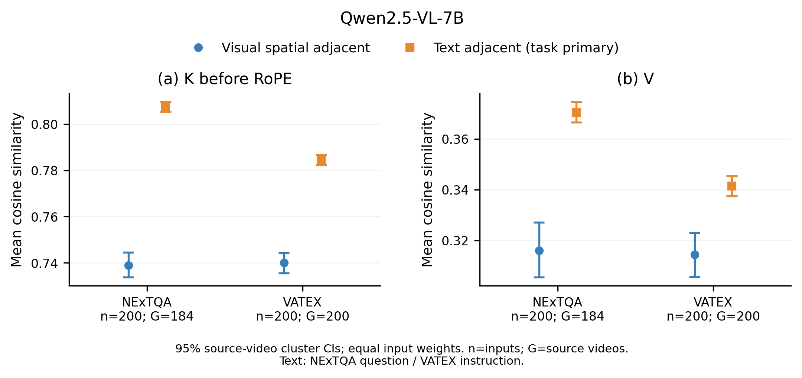

# 观察 A 的实际结果：Qwen2.5-VL-7B，两个数据集各前200条

**400/400 条全部完成，正式运行约38.0分钟，无失败、替换或 M=0 排除。** 本次固定口径下，视觉空间近邻的 raw K、V 平均相似度均低于对应文本近邻；四个配对均值差的95%视频聚类 bootstrap 区间均低于0。

这组数据不支持“视觉近邻普遍比文本近邻更相似”的表述。两种输入来源中，K 的均值都高于 V；但这项观察不能直接证明合并安全或压缩质量。完整协议见 [OBSERVATION_A.md](OBSERVATION_A.md)。

## 主结果

余弦相似度先在每个输入内平均配对、4个KV头与28层，再对规定的200行等权汇总。差值为视觉减文本；置信区间按源视频整组重采样5000次。文本分别为 NExTQA 问题和 VATEX 描述指令。

| 数据集 | 指标 | 视觉近邻均值 | 文本近邻均值 | 视觉−文本 | 配对差值95% CI |
|---|---|---:|---:|---:|---|
| NExTQA | raw K（RoPE前） | 0.738970 | 0.807565 | −0.068595 | [−0.074279, −0.062860] |
| NExTQA | V | 0.315928 | 0.370496 | −0.054568 | [−0.066217, −0.042985] |
| VATEX | raw K（RoPE前） | 0.739972 | 0.784491 | −0.044519 | [−0.049584, −0.039596] |
| VATEX | V | 0.314344 | 0.341388 | −0.027044 | [−0.036908, −0.016995] |

实际 RoPE 后 K 的补充结果方向相同：NExTQA视觉−文本为−0.060199，VATEX为−0.036036，两个区间也均低于0；完整数值保存在CSV中。

[主图 PDF](../provenance/observation_a_qwen7b_20261104/report/adjacent_main.pdf) · [可编辑 SVG](../provenance/observation_a_qwen7b_20261104/report/adjacent_main.svg) · [任务数值与区间 CSV](../provenance/observation_a_qwen7b_20261104/report/task_summary.csv)

## 样本、覆盖与耗时

| 项目 | NExTQA OE/test | VATEX/test |
|---|---:|---:|
| 原始行范围 | 0–199 | 0–199 |
| 完成／有效配对输入 | 200／200 | 200／200 |
| 源视频聚类数 | 184 | 200 |
| 主视觉与主文本各自的配对总数 | 2079 | 3200 |
| 每个输入的主配对数 | 3–16，均值10.395 | 16 |
| 存在补齐重复采样的输入 | 90／200 | 49／200 |

模型 snapshot 为 `cc594898137f460bfe9f0759e9844b3ce807cfb5`，A800 80GB 单卡、BF16、64帧、batch=1。使用原生完整多模态 backbone，未压缩、不生成、不调用评分API，跳过无关LM head。全部28层、4个原生KV头均捕获一次 raw K、V、RoPE K，没有把GQA展开后的query头当独立KV头。

正式任务UTC时间为 **2026-11-04 07:16:00–07:54:01**，含模型加载和统计绘图约2280.4秒。正式运行前各2条计时样本外推约80分钟，已告知预留1–2小时；实际更多视频的解码较快，因此最终耗时约38分钟。计时pilot与正式数据目录独立。

`frame_sampling` 索引指 qwen-vl-utils 初次准备后的帧池，再重采样到64槽的索引，不是源视频解码帧号。重复采样记录随[样本清单](../provenance/observation_a_qwen7b_20261104/sample_manifest.json)保存，本轮不从这些数据作自然时序冗余的推断。

## 层与头的异质性、解释边界

总体均值为负，不意味着每层、每头都如此。全部112个(layer, KV-head)单元中，视觉均值高于文本的单元数分别为：NExTQA raw K 34、V 29；VATEX raw K 39、V 32。28层均值中，相应正差值层数为7、8、9、8。这些计数仅为描述，不是逐头显著性检验；完整[逐头CSV](../provenance/observation_a_qwen7b_20261104/report/head_summary.csv)和[逐层CSV](../provenance/observation_a_qwen7b_20261104/report/layer_summary.csv)保留全部单元。

- 视觉配对仅为同一模型时间网格、同一行的水平近邻；每输入最多16对，并非所有视觉近邻的穷举均值。
- 文本池是任务内指定的自然语言部分。VATEX四段文本示例仍参与前向，但不进入主文本统计；NExTQA固定答题指令作为单独补充，不混入问题均值。
- 输入位置、文本角色和上下文不同，深层表示已受多模态上下文影响。这是当前输入与统计口径下的条件观察，不是模态自身的因果效应或所有VLM的普遍结论。
- 本轮仅有近邻对，没有随机/远距对照或合并干预；不能把结果称为“局部性增益”或合并效果的证明。未为了得到特定方向而更改样本、层头或文本池。

## 复核证据

独立程序不调用报告统计函数，从原始400行重算六组指标的18个点估计，逐项差值为0；原始结果SHA与报告一致。完整性检查没有缺行、重复ID、无效值或层头错误。新增55项观察测试全部通过；完整105项CPU回归104通过、1项历史来源可选检查跳过。压缩核心30个来源目标检查通过，本轮未改压缩算法。

[实验与文件SHA索引](../provenance/observation_a_qwen7b_20261104/artifact_index.json) · [运行协议](../provenance/observation_a_qwen7b_20261104/contract.json) · [真实运行状态](../provenance/observation_a_qwen7b_20261104/run_state.json) · [机器可读统计](../provenance/observation_a_qwen7b_20261104/report/summary.json) · [逐输入CSV](../provenance/observation_a_qwen7b_20261104/report/record_summary.csv)

原始69,212,112字节的 `records.jsonl` 留在本机 `outputs/observations/qwen7b_adjacent_first200_20261104/`，SHA256为 `43ab745ed11b9fc6ee8b5a670bba428a677f33565b8f74493583d37f18d2551f`。Git只保存统计、图、样本元信息及来源证据，不包含权重、视频或完整向量。元信息不等于所有权重/视频payload和运行库的完整依赖闭包哈希。
