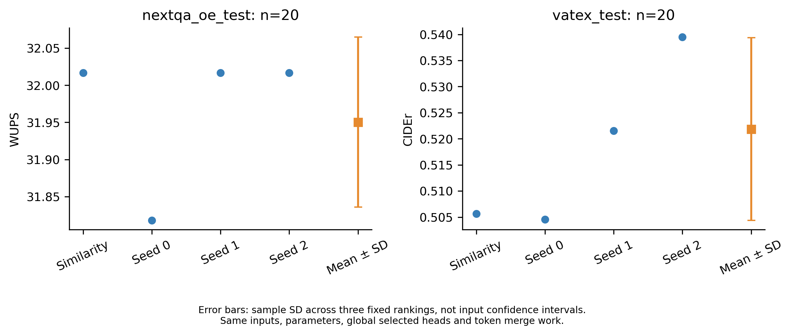

# Random-head 小样本消融结果（2026-11-04）

**已完成160次生成；本轮没有得到“相似度选头稳定优于随机选头”的证据。** NExTQA差异很小，VATEX的Random均值反而更高。不能将该结果写成Head Selection有效性的正向证明。

## 范围与对照

[完整协议](RANDOM_HEAD_ABLATION.md)：Qwen2.5-VL-7B + SnapKV-KVRepack，NExTQA OE/test、VATEX/test各原始前20行，比较原相似度全局Top-K与均匀无放回的全局Random-head（种子0/1/2）。每个种子使用固定模型级随机排序，两个任务共享同一排序。仅替换选择掩码；64帧、10%预算、候选、合并函数、greedy/BF16/FA2、生成上限128及其他算法参数保持一致。

NExTQA `(simtop,cr,alpha)=(.30,.70,2)`，选34/112个原生KV head；VATEX `(.15,.70,.5)`，选17/112个。Global Random允许层间配额变化；实现中的逐层配额匹配策略未运行。首轮选择SnapKV便于在统一逐头预算下审计，这不是原文HybridKV All-head表的完整消融，也未覆盖其他模型或方法。

## 实际得分

| 数据集 | 指标 | 相似度选头 | Random seed 0 | seed 1 | seed 2 | Random均值 ± 样本SD | 原策略−Random均值 |
|---|---|---:|---:|---:|---:|---:|---:|
| NExTQA | WUPS | 32.016623 | 31.817793 | 32.016623 | 32.016623 | 31.950346 ± 0.114795 | +0.066277 |
| VATEX | Bleu_4 | 0.292531 | 0.290201 | 0.295682 | 0.309831 | 0.298571 ± 0.010129 | -0.006040 |
| VATEX | METEOR | 0.249811 | 0.249394 | 0.250159 | 0.254448 | 0.251334 ± 0.002724 | -0.001523 |
| VATEX | ROUGE_L | 0.449622 | 0.450307 | 0.455429 | 0.466309 | 0.457348 ± 0.008172 | -0.007727 |
| VATEX | CIDEr | 0.505653 | 0.504543 | 0.521529 | 0.539502 | 0.521858 ± 0.017482 | -0.016205 |

NExTQA原策略相对三个Random种子均值仅高0.066277 WUPS点；按源视频聚类、固定这三个种子的配对bootstrap 95%区间为[0.000000, 0.198830]，包含0。种子0只有doc15从`clean spoon`变成`clean mouth`；种子1、2的全部预测与原策略相同。不能把这20条描述为稳定优势。

VATEX的Random均值在BLEU-4、METEOR、ROUGE-L和CIDEr均高于原策略；这是小样本描述性结果，不足以推断Random整体更好。种子0/1/2分别改变1/3/6条预测。VATEX采用同一20条参考池的官方语料级评分，CIDEr的文档频率依赖此参考池，不能与历史200条或全量分数直接比较。WUPS以0–100点报告；VATEX均为原始语料分数，未乘100。SD是三个固定随机排序的样本标准差（ddof=1），不是输入置信区间；三个种子没有产生60个独立输入。

[PDF图](../provenance/random_head_snapkv7b_20261104/report/task_scores.pdf) · [逐层选头频率图](../provenance/random_head_snapkv7b_20261104/report/head_selection.png) · [完整分数CSV](../provenance/random_head_snapkv7b_20261104/report/seed_summary.csv)

## 实际执行与核对

- 8组各20条，共160条；全部正常EOS结束，无生成上限命中，无换样或按结果筛选。
- 四组逐输入的模型输入字节和28层候选张量SHA完全相同，所有非选头配置一致。
- NExTQA每条实际合并34头，累计移除token数12,478–18,292；VATEX实际17头、6,273–16,915。同一输入的所有条件移除量和28层prefill缓存形状完全匹配。上述移除量按被合并head累计，并非独立输入token数量。
- 三个Random模型掩码固定且彼此不同，已独立从seed重建验证；VATEX的17头是同seed NExTQA34头排序的前缀子集。
- 正式首组开始至最后一组完成为UTC13:11:31–13:28:56，约17分24秒，含视频准备、加载、一次准备重试与调度间隔。累计generate计时298.229秒，包含实验审计开销；不能当作纯GPU性能基准。
- VATEX最初两个CPU准备任务误并行，伴随文件检查在doc15中止了首个VATEX worker，GPU生成0条。重复任务已停止，已存16条均重新校验后串行补齐；失败状态单独保存，未混入正式结果。
- CPU suite 205项：204通过，1项旧来源差分测试按其配置跳过；新增30项选头/缓存/评分检查通过。来源检查30个核心文件、50个本地模块/adapter通过；核心压缩文件未修改。

## 结论与证据

本轮完成了公平Random-head对照的实现与真实GPU验证，但样本表现没有证明相似度选择带来稳定收益。若正文需要为选择策略本身提供实验证据，应在预先确定的主方法与较大测试集上沿用同样参数和多随机种子进行比较，按实际结果报告；不能改用All-head代替，也不应在看完结果后选择有利样本或调参。

[独立执行审计](../provenance/random_head_snapkv7b_20261104/independent_audit.json) · [小型可复核证据与完整性索引](../provenance/random_head_snapkv7b_20261104/README.md) · [评分源码](../src/kvrepack/ablations/head_selection_report.py)

本轮已结束，GPU已释放。不自动扩大到200条、全量、其他方法或恢复历史停止任务。
