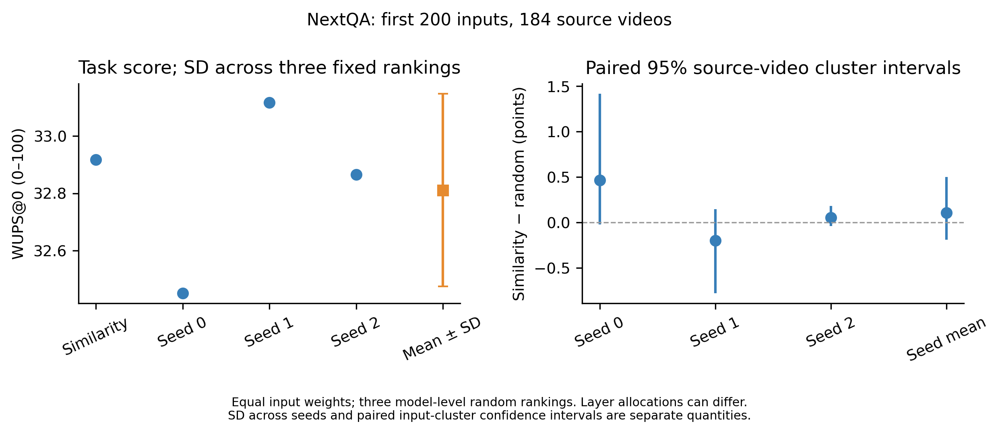

# NExTQA 前200条 Random-head 消融结果

实验于 **2026-11-04** 运行，**2026-11-06** 复核。原始 `doc_id=0..199` 的四组共800次生成及自动评分均已完成，GPU已释放。本轮结果未显示相似度选头稳定优于Random-head，也不能证明两者等效。

## 实验范围

[完整协议与复现命令](RANDOM_HEAD_NEXTQA_200.md)：Qwen2.5-VL-7B-Instruct + SnapKV-KVRepack，NExTQA OE/test原始前200行，包含184个源视频。保持64帧、10% KV预算、`(simtop,cr,alpha)=(.30,.70,2)`、BF16/FlashAttention 2、greedy、生成上限128和repetition penalty 1.05，比较原相似度全局Top-K与Random-head种子0、1、2。

四组均从28层×4个原生KV head的112个候选中选择并实际合并34个head。Random在全模型均匀无放回选择；每个种子使用固定模型级排序，所有输入复用。它保持全局配额，允许层间配额变化；本轮未运行逐层数量匹配策略。

原策略与Random复用同一输入，保持候选构造、合并函数及参数一致。本轮没有重新运行All-head，也不把历史HybridKV的All-head分数拼入本表。这里的结果仅覆盖SnapKV-KVRepack 7B分支和前200条输入。

## 得分与配对差值

使用原任务的WUPS@0聚合，以0–100点报告，数值越高越好。“差值”始终为相似度选头减去对应Random，保留负值。

| 条件 | WUPS | 相似度−Random | 95%配对区间 |
|---|---:|---:|---|
| 相似度选头 | 32.917681 | — | — |
| Random seed 0 | 32.450740 | +0.466941 | [−0.020255, 1.416900] |
| Random seed 1 | 33.116603 | −0.198922 | [−0.781282, 0.147509] |
| Random seed 2 | 32.865783 | +0.051898 | [−0.039178, 0.181910] |
| Random均值 ± 样本SD | 32.811042 ± 0.336289 | +0.106639 | [−0.191880, 0.501384] |

原策略相对三个Random种子的均值仅高0.106639点；种子1的分数反而更高。均值差的区间跨过0，因此这组结果不支持“相似度选择稳定优于随机选择”的论断。它也不是等效性检验，不能据此认定选择策略没有作用或两者等效。

SD是三个固定随机排序的样本标准差（`ddof=1`）。配对区间使用5000次源视频聚类bootstrap：每次抽样同时保留该视频的全部问题，并为四条件复用同一组抽样；区间条件于这三个固定种子。200条输入、184个源视频和3个随机种子不能解释为600个独立输入。

[PDF图](../provenance/random_head_snapkv7b_nextqa_200_20261104/report/nextqa_scores.pdf) · [各条件分数CSV](../provenance/random_head_snapkv7b_nextqa_200_20261104/report/run_scores.csv) · [逐输入配对分数](../provenance/random_head_snapkv7b_nextqa_200_20261104/report/paired_scores.csv) · [完整评分摘要](../provenance/random_head_snapkv7b_nextqa_200_20261104/report/summary.json)

## 执行与核对

- 每条件200条，共800条，均正常EOS结束，无128-token上限命中；无换样、漏行或旧预测拼接。
- 独立执行审计对600组Random与原策略配对检查输入、候选、配置、原始掩码、合并工作量及缓存形状，未发现问题；8个冻结源码SHA与运行记录匹配。
- 每条件实际合并34个head，同一输入的总移除量和28层prefill缓存形状一致。跨输入移除量为12,376–33,660，按被合并head累计，不是独立输入token数量。
- 原相似度策略出现39种选择掩码；每个Random种子固定一种掩码，三个种子彼此不同。相比原策略，种子0/1/2分别改变6/6/4条预测，说明干预实际生效。
- 生成worker墙钟耗时1809.701921秒，约30分9.7秒，含输入准备、模型加载与执行审计；自动评分耗时约10.8537秒。控制器从启动至评分与绘图结束约30分29.55秒。这些计时不作为纯GPU性能基准。

11月6日另从原任务函数与同一Arrow逐条独立重算800条WUPS，未复用原报告的评分缓存：主、次WUPS与逐条CSV的最大差均为0；三个种子的均值、标准差、配对差和184个源视频的聚类区间也与报告一致。全部原报告文件在复核前后的SHA保持不变。

[独立执行审计](../provenance/random_head_snapkv7b_nextqa_200_20261104/independent_200_audit_20261106.json) · [独立评分复核](../provenance/random_head_snapkv7b_nextqa_200_20261104/independent_200_scoring_check_20261106.json) · [逐条件选头审计CSV](../provenance/random_head_snapkv7b_nextqa_200_20261104/report/selector_audit.csv) · [可复核证据与压缩样本](../provenance/random_head_snapkv7b_nextqa_200_20261104/README.md)

## 可用于正文的表述

> 在NExTQA前200条样本上，保持KV预算与合并head数量一致，相似度选头的WUPS为32.9177，Random-head（三个种子）为32.8110±0.3363；配对均值差为+0.1066点（95%源视频聚类bootstrap区间：−0.1919至0.5014），尚无证据表明相似度选头稳定优于随机选头。

该表述限定于本轮SnapKV-KVRepack设置，不延伸到其他方法、模型、数据集或完整9178条测试集。所有结果按实际方向报告。本轮已结束，不自动追加VATEX、更多样本或其他实验。
