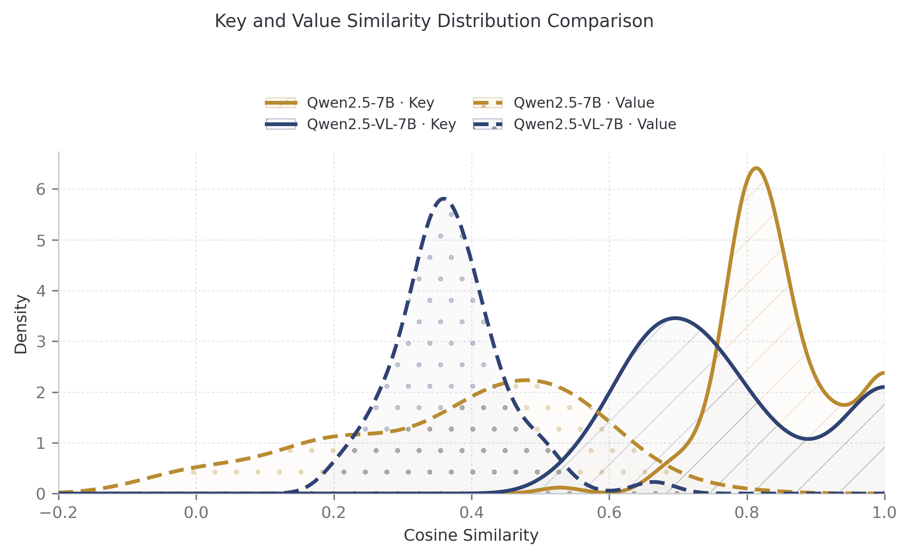

# Qwen2.5两模型各200条：相邻token余弦结果

此次计算的是完整序列全部相邻位置`(i,i+1)`的余弦相似度，每输入恰好`N−1`对；没有token/pair抽样。此前全配对图是所有`i≠j`，两种结果分别保留，不混用。

Qwen2.5-7B-Instruct使用LongBench/qasper原始前200条；Qwen2.5-VL-7B-Instruct使用OCRBench固定0、5至995行，共200条。全部400条完成，每条输入tensor哈希、聊天SHA、来源metadata与此前全配对实验一致。两模型固定revision、BF16、FlashAttention2和原生完整前向沿用原设置。

| 指标 | Qwen2.5-7B | Qwen2.5-VL-7B | 图文减纯文本 |
|---|---:|---:|---:|
| K：RoPE前 | 0.843658 | 0.751111 | −0.092547 |
| K：RoPE后 | 0.835541 | 0.749498 | −0.086043 |
| V | 0.377914 | 0.368567 | −0.009347 |

相邻统计下三项总体均值均为纯文本组更高。RoPE后K和V的组差95%来源聚类bootstrap区间分别为[−0.089525,−0.082514]和[−0.014844,−0.003746]；这些是固定来源集的观察性对照，两组模型、数据、长度及token角色不同，不能据此隔离模态自身的影响或断言merge安全。

[精简TXT](reference_adjacent_qwen25_200.txt) · [完整精度CSV](reference_adjacent_qwen25_200.csv) · [协议与启动命令](REFERENCE_ADJACENT_200_20261117.md)。

## 连续分布图

主图使用RoPE后K与V，每个层/原生KV头先对200条输入等权平均，得到112个均值，再做连续KDE；曲线不是百万个原始相邻对余弦值的密度。金色为Qwen2.5，蓝色为Qwen2.5-VL，组合图K实线斜纹、V虚线点纹。

[组合图PDF](../provenance/reference_adjacent_qwen25_200_20261117/final/report/adjacent_combined.pdf) · [K分图](../provenance/reference_adjacent_qwen25_200_20261117/final/report/adjacent_key.png) · [V分图](../provenance/reference_adjacent_qwen25_200_20261117/final/report/adjacent_value.png) · [RoPE前K补图](../provenance/reference_adjacent_qwen25_200_20261117/final/report/adjacent_raw.png)。

## 相邻定义和覆盖

每层每个头计算`mean_i cosine(x[i], x[i+1])`，用FP32归一化与FP64点积/归约，保留负值。然后对规定输入、层、KV头等权平均，不按输入长度加权。全部28层、4个GQA重复前的原生KV头参与。

| 组别 | 输入数 | 输入token最小/最大/均值 | 相邻位置对累计数 |
|---|---:|---|---:|
| 纯文本 | 200 | 2094 / 22064 / 5211.42 | 1,042,084 |
| 图文 | 200 | 61 / 16308 / 1076.28 | 215,056 |

相邻位置对累计数是每输入`N−1`求和，每个层/头都对这些位置作测量。图文统计包含整个prompt中的图像、文本、结构token及其边界，按序列索引判断相邻；包括图像展平的跨行边界。因此这不是单独视觉token池、二维纯水平近邻或此前每侧最多16对的NExTQA/VATEX实验。

与旧全配对数值相比，纯文本的post-K由0.498643变为0.835541，图文由0.574448变为0.749498，排序发生变化。这是同批完整输入下统计对象不同的结果，不能把全配对图直接称为相邻图。

## 执行、验证及归档

正式UTC2026-11-17T00:33:12至00:36:04，控制器总172.093519秒；包含两模型加载、采集、CPU统计和初次绘图。两个worker分别87.523645和70.818295秒。计时仅说明本轮观察任务耗时，不当成生成性能基准。前置2＋2 pilot独立保留，不并入正式400条；后续仅CPU检查和图例布局调整，没有追加GPU前向。

14项observer CPU检查、11项report CPU检查通过，覆盖逐相邻oracle、与全配对的区别、全部N−1端点、BF16/负值、捕获与前向不变、异常清理、跨统计类型拒绝、等输入权重和图形渲染。新组合图图例布局另经渲染检查。30份压缩核心保持不变。

[独立复核](../provenance/reference_adjacent_qwen25_200_20261117/independent_verification.json)从400条记录重算逐输入/头/层/组/差值CSV，核对全部输入与旧实验一致、统计标识与N−1计数、完整覆盖和冻结来源。该审计不运行GPU，也不能用保存的均值重新计算未保存的原始token向量余弦；后者由CPU公式oracle和正式native捕获路径验证。

原始ROOT为`outputs/observations/qwen25_sequence_adjacent_200_20261117`；[发布清单](../provenance/reference_adjacent_qwen25_200_20261117/final/release_manifest.json)、原始记录压缩包、逐文件SHA及完整报告保存在`provenance/reference_adjacent_qwen25_200_20261117/final/`。权重、图片、长文本prompt不随Git发布。采集源码版本`ba70c1a`，报告首次版本`c4d77c1`；组合图仅后续CPU渲染调整。
