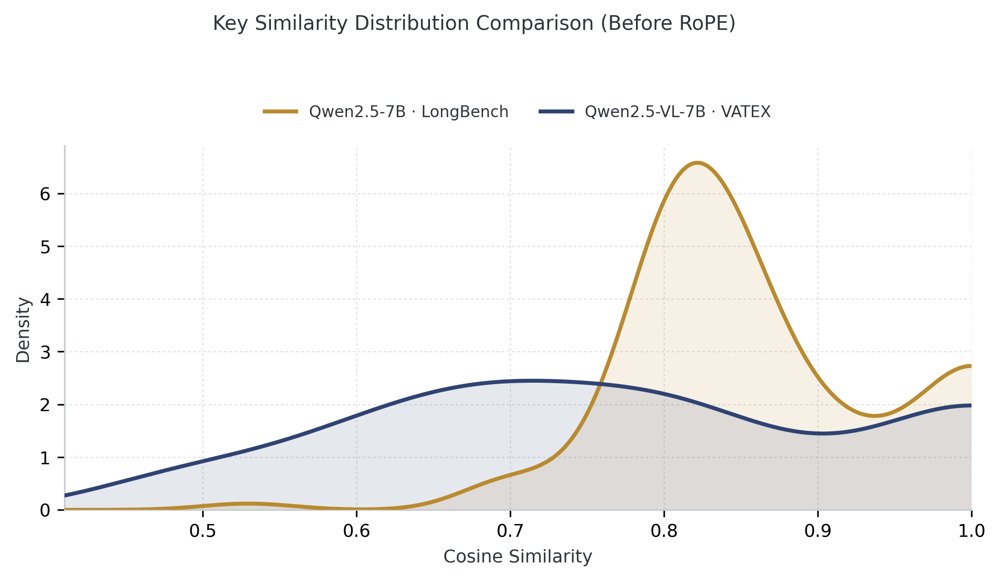

# VATEX与LongBench：RoPE前raw K结果

两组原始前200条已全部完成。用户最终确认关注**全部相邻对**，top200另列作已完成对照。

| 数据集 / 模型 | 全部相邻对均值 | 每输入/层/头最高200对均值 |
|---|---:|---:|
| VATEX / Qwen2.5-VL-7B | 0.740228 | 0.971907 |
| LongBench Qasper / Qwen2.5-7B | 0.843658 | 0.951488 |

全部相邻统计下LongBench更高；top200统计下VATEX更高0.020419。两种统计分别保留，不把选出的最高值冒充全部邻接均值。每条完整输入共有N−1个(i,i+1)，取均值后对输入、28层和4个原生KV头等权，不按长度加权。raw K是当前层RoPE前投影，并非关闭整个模型的位置编码。

[TXT](vatex_longbench_raw_k_200.txt) · [完整精度CSV](vatex_longbench_raw_k_200.csv) · [协议与命令](VATEX_LONGBENCH_TOP200_RAWK_20261117.md)。

[全部相邻图PDF](../provenance/vatex_longbench_top200_rawk_20261117/final/report/raw_k_all_adjacent.pdf) · [top200图PDF](../provenance/vatex_longbench_top200_rawk_20261117/final/report/raw_k_top200.pdf)。两图都用112个层/KV头的200输入均值做KDE，并非逐pair密度。

VATEX候选位置对累计2380152，LongBench1042084（每层每头）；固定选200并不控制候选池大小。VATEX包含完整视频prompt，64帧，选出的448万对中4444318对两端均为视频token，占99.203527%；占位token ID相同不代表K向量相同。两组模型、数据、长度不同，此观察不隔离模态因果效应，也不证明合并安全。

全邻接补充值：post-RoPE K为VATEX0.740038643、LongBench0.835541243；V为0.312232132/0.377913702。它们是全部相邻对均值，未按raw K所选200对重新取V/post-K。

正式UTC01:02:02至01:41:33，总2370.365906秒（约39分30秒），包含首attempt的SIGTERM和恢复。已完成LongBench101.761302秒、恢复VATEX1554.830197秒；恢复控制器1564.358439秒，不能当成整个任务总时长。LongBench200条未重跑。控制器中断处理另有两项真实CPU回归通过，见协议与独立审计。

[独立审计](../provenance/vatex_longbench_top200_rawk_20261117/independent_verification.json)核对400输入、400NPZ、896万选中分数、5类CSV和模型/来源/版本，最大均值误差2.22e−16；全邻接补图只追加渲染，原raw/CSV/top200图和统计不变。原始向量与未选中候选分数未保存，审计不能独立从向量重证top200排序；其依据为显式CPU排序oracle及原生捕获代码。

[发布清单及压缩包SHA](../provenance/vatex_longbench_top200_rawk_20261117/final/release_manifest.json)保存428个原始文件的分组归档、逐文件SHA与完整报告。把final中的5个tar.gz解压到同一目录即可重建原运行树；不包含权重、视频和长文本prompt。采集数值源码48df172，控制器修复dd1c797。
